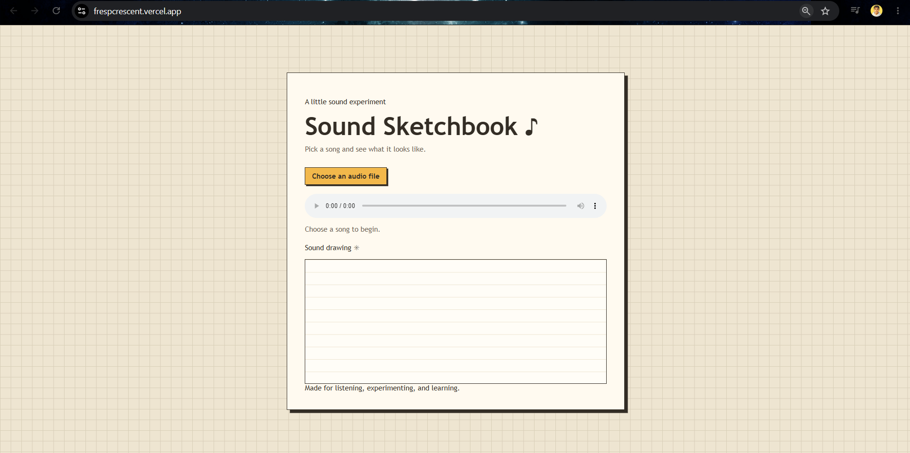
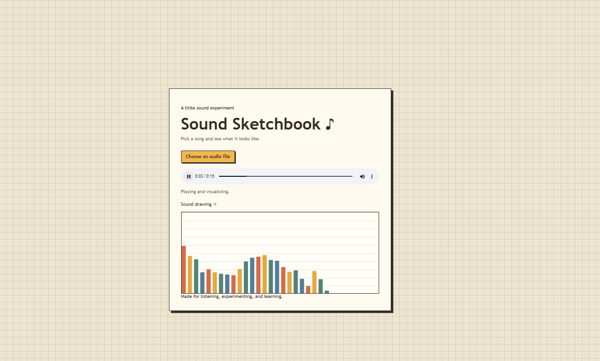

# Fresp Voice Bar Crescent

My project is basically an Audio Visualizer, which plays an audio file, to see 32 colored bars, that react to its frequencies in real time. This is built with Canvas and Web Audio Api.

## Screenshot

This screenshot shows the picture of the demo live on vercel - frespcrescent.vercel.app 

This screenshot shows the visualizer actually working 

## How to run it

1. Open frespcrescent.vercel.app on your browser, or just open the html along on your browser (along with the other files present).
2. Then Click on the "Choose an audio file" option, and select an audio file from your desktop.

## How it works

Once you have your audio file in there, you can click on the play button, which start to play it, and it will show 32 multi colored bars, which will go up and down, to show the loudness/frequencies of the audio/song, which we call "Sound Drawing". It works with any kinds of audios, song, or podcast, or even a normal recording, but it must be .mp3 (audio file).

## Tools and sources

- HTML, CSS, and JAVASCRIPT
- Canvas api for drawing the bars.
- Web Audio api for reading audio frequencies (Analyser Node)
- Crescent Visualizer card guide which was used: https://crescent.hackclub.com/guides/visualizer

## Credits

- Help used: Chatgpt helped in revising the code where there were errors, troubleshooting.